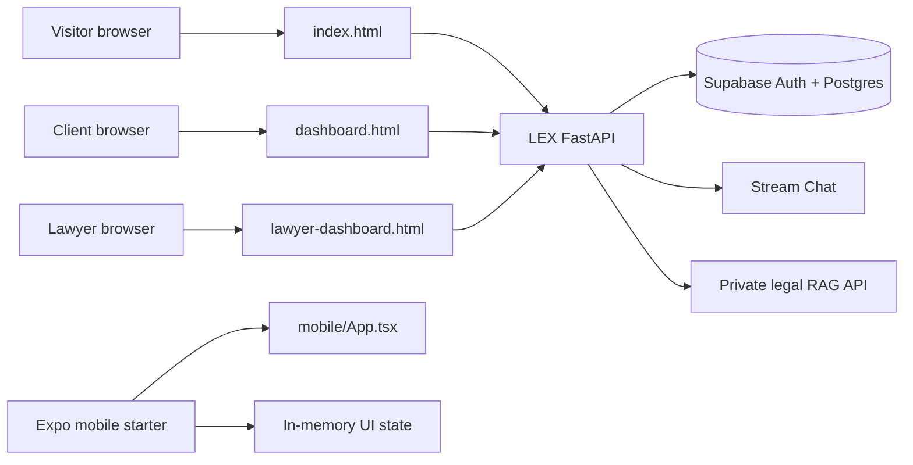
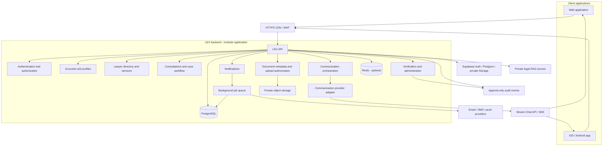
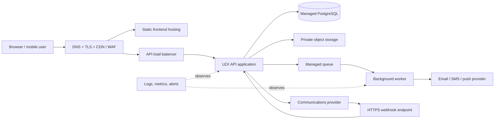

# LEX Architecture

## Purpose and scope

This document describes the current LEX prototype, the backend foundations now implemented
in this repository, and the remaining production architecture.

LEX is a legal-services platform for clients and lawyers. The current repository contains
the website frontend, a Python/FastAPI API, Supabase-backed authentication/profile metadata,
a Stream Chat integration, and an Expo / React Native mobile starter.

## Current prototype



- `index.html` uses the LEX API for Supabase email/password registration and sign-in.
- `dashboard.html` uses the API for the legal assistant and verified-lawyer Stream chat.
- `lawyer-dashboard.html` uses Stream for authorized personal chats and the verified-lawyer lounge.
- Supabase Auth owns identity; Postgres stores profiles and conversation metadata. Browser session
  tokens are held in `sessionStorage`; provider secrets remain server-side.
- The legal RAG service is based on the fork under `LLM-for-legal-advices/` and is called only by
  the LEX API using a private service key.
- The mobile app in `mobile/` is a UI starter and does not currently call a LEX backend.
- A lawyer is not eligible for chat until its server-controlled verification flag is set.
- Case management, full directory metadata, general client document workflows, payments,
  notifications, and sample dashboard content are not backend features yet. Lawyer verification
  documents use private Supabase Storage and administrator-controlled scanning/review.

## Implemented backend foundation

`backend/app/` separates configuration, Supabase clients, authentication/authorization, and API
routes. The endpoints cover authentication/session refresh, lawyer applications and admin review,
private verification-document storage, verified-lawyer discovery, Stream Chat token/channel
provisioning, and a bounded legal-assistant proxy. Database setup is in
`backend/supabase/migrations/001_initial_chat_backend.sql`.

The model service has its own `api.py`, `rag.py`, and environment configuration in the fork. Its
source repository does not include the legal PDF corpus or vector database. Supply legally
reviewed source materials and build the index before enabling AI responses.

## Target production architecture



### Recommended initial shape

Start with a **modular monolith** behind a versioned HTTPS API rather than several microservices. It is simpler to deploy and operate while the product and team are small. Keep modules and provider integrations behind interfaces so that high-load modules or vendors can be separated later without changing the client-facing API.

Suggested starting components:

| Component | Responsibility |
|---|---|
| Web frontend | Client and lawyer workflows; calls only the LEX API for protected data |
| Mobile frontend | Same business APIs and authorization rules as the web frontend |
| LEX API | Validation, business rules, role/case authorization, and vendor orchestration |
| Supabase | Auth, PostgreSQL records, and private Storage for lawyer verification documents |
| Private object storage | Supabase Storage; only scoped metadata is exposed to applicants |
| Job queue / worker | Email, reminders, webhook processing, virus scanning, and retryable work |
| Redis (optional initially) | Short-lived cache, rate limits, and transient coordination; not the source of truth |
| Third-party communication provider | Real-time chat, voice calls, and video meetings through an SDK/API |

The current implementation uses Python/FastAPI, Supabase, and Stream Chat. Production hosting,
provider data-processing terms, data residency, availability in Sri Lanka, and cost still need
review before launch.

## Functional backend modules

1. **Identity and access** — account registration, sign-in, password recovery, optional MFA, sessions, and role-aware access for clients, lawyers, and administrators.
2. **Lawyer onboarding** — application submission, private verification-document upload, review workflow, approval or rejection, and a recorded reviewer/audit trail. Do not expose a lawyer as verified merely because an application was submitted.
3. **Directory and services** — approved lawyer profiles, practice areas, languages, jurisdictions, service descriptions, availability, and searchable filters.
4. **Consultations and cases** — client request, lawyer selection or assignment, appointment, case status, participant permissions, and cancellation/rescheduling rules.
5. **Documents** — metadata and ownership in PostgreSQL; file bytes in private object storage. Use short-lived, scoped upload/download URLs issued by the API, plus file type/size checks and malware scanning.
6. **Communication orchestration** — authorize consultation participants, create provider rooms/channels/calls, issue short-lived client tokens, validate provider webhooks, and keep only the communication metadata needed by LEX.
7. **Notifications and reminders** — durable reminder records and queued email, SMS, or push delivery; clients must be able to manage notification preferences.
8. **Administration and audit** — verification review, support tools, least-privilege administration, and auditable actions for sensitive records.
9. **Optional later modules** — payments, AI document assistance, and public/community discussions. AI should be isolated behind a server-side adapter and must not be represented as legal advice.

## Third-party chat, voice, and video

LEX should own **who is allowed to communicate, why, and when**. The selected communications provider supplies the live communication service and client SDKs.

### Call / meeting flow

1. The client requests a call or meeting for an existing consultation through the LEX API.
2. The API checks that the requester is an active participant, the consultation is allowed to communicate, and the lawyer’s account has the required status.
3. The API creates or reuses a provider room using server-held credentials, associates it with a LEX consultation, and persists the provider room ID and lifecycle metadata.
4. The API returns a short-lived provider join token with only the required room and participant permissions. Provider secrets are never sent to the browser or mobile app.
5. The web or mobile client joins using the provider SDK. The provider transports audio/video; LEX does not build its own media infrastructure.
6. The provider sends signed lifecycle webhooks (for example, participant joined or meeting ended). The LEX API verifies the signature, processes events idempotently, and updates the consultation’s communication status.

Voice calls can use the same pattern if supported by the selected provider. Clarify whether “call” means an in-app internet voice call or a call to a telephone number; PSTN calling has separate country availability, consent, and cost considerations.

### Chat flow

1. The API authorizes the user for a consultation conversation and provisions or retrieves a provider channel.
2. The API issues a short-lived, user-scoped Stream Chat token, or uses the server-side provider API to authorize the SDK session.
3. The chat SDK sends and receives messages directly through the provider. The provider’s signed webhooks can update LEX unread counts and conversation metadata.
4. LEX stores the provider channel ID and minimal required metadata. Store message bodies in LEX only if product, retention, export, and legal requirements explicitly call for it; avoid accidental duplication of confidential content.

### Provider integration boundary

Implement a `CommunicationProvider` adapter with operations such as:

- `createRoom` / `createChannel`
- `issueParticipantToken`
- `revokeParticipant` / `closeRoom`
- `verifyWebhook`
- `parseWebhookEvent`

Keep provider-specific IDs and webhook payload parsing inside the adapter. The frontend should use a provider SDK only with short-lived tokens issued by LEX. Provider API credentials, signing keys, and webhook secrets belong in a server-side secret manager.

Before choosing a vendor, compare web and mobile SDK support, voice/video/chat coverage, data residency and subprocessors, encryption details, retention/deletion controls, accessibility, uptime/support, pricing, and export/migration options. A provider’s encryption model may limit LEX’s ability to moderate, search, retain, or export message contents; make that trade-off explicit.

## Suggested data model

Use UUID primary keys and UTC timestamps. Example entities:

- `users` — login identity, normalized email/phone, status, timestamps.
- `roles` / `user_roles` — client, lawyer, admin; authorization remains server-side.
- `client_profiles` — client-specific profile fields.
- `lawyer_profiles` — professional details, jurisdiction, verification state, visibility.
- `lawyer_verification_documents` — private object key, document type, review status, reviewer, retention dates.
- `services` — lawyer-owned service name, category, description, price/consultation terms if applicable, publication status.
- `consultations` — client, lawyer, status, schedule, jurisdiction/context fields kept to the minimum necessary.
- `consultation_participants` — participant, consultation, permissions, join/leave status.
- `communications` — consultation, provider, provider room/channel ID, communication type, state, lifecycle timestamps.
- `messages` — only if LEX itself is the system of record for chat content; otherwise retain provider references and required metadata only.
- `documents` — owner/consultation, private storage key, content type, size, checksum, scan status, retention state.
- `notifications` — recipient, type, delivery state, scheduled time, retry metadata.
- `audit_events` — actor, action, target, timestamp, and safe metadata; exclude secrets and unnecessary sensitive content.

Avoid storing full legal narratives, identity documents, or message content in logs and analytics. Define deletion, legal hold, backup, and retention rules before launch.

## Example API surface

All endpoints require TLS, validation, authentication as appropriate, authorization on every request, and a consistent error format.

```text
POST   /api/v1/auth/register
POST   /api/v1/auth/login
POST   /api/v1/lawyer-applications
GET    /api/v1/lawyers?practiceArea=&district=
GET    /api/v1/lawyers/{lawyerId}/services
POST   /api/v1/services
PATCH  /api/v1/services/{serviceId}
DELETE /api/v1/services/{serviceId}
POST   /api/v1/consultations
GET    /api/v1/consultations/{consultationId}
POST   /api/v1/consultations/{consultationId}/communications
POST   /api/v1/consultations/{consultationId}/communications/{communicationId}/token
POST   /api/v1/webhooks/communications/{provider}
POST   /api/v1/documents/upload-authorizations
GET    /api/v1/documents/{documentId}/download-authorization
```

The webhook endpoint is authenticated by provider signature verification, not by a user session. Enforce idempotency for webhook event IDs and for actions that create paid or external resources.

## Security, privacy, and reliability requirements

- Enforce authorization on the server for every user, role, consultation, file, and provider token. Never rely on hidden UI controls.
- Use short-lived access credentials, secure refresh/session handling, MFA for administrators, rate limits, and abuse monitoring.
- Encrypt network traffic and stored data; keep secrets outside source control and client bundles.
- Give provider join tokens minimum permissions, short expiry, and a single participant/room scope. Revoke or close access when a consultation ends or is cancelled.
- Verify webhook signatures, reject replayed/invalid events, and make processing idempotent.
- Keep legal documents private, scan uploads, audit access, and use signed URLs with short expiry.
- Establish informed consent for calls/recording. Do not record by default; if recording is introduced, define consent, access, retention, deletion, and applicable legal requirements first.
- Minimize sensitive data collected, set retention/deletion schedules, and assess applicable Sri Lankan privacy law, professional confidentiality duties, provider terms, and cross-border data transfers with qualified counsel.
- Back up PostgreSQL and object storage, test restores, monitor API and provider failures, and provide a safe fallback when communications are unavailable.
- Never claim that a lawyer is verified, a document is securely stored, a message was delivered, or an AI result is reliable unless the corresponding backend operation confirms it.

## Deployment view



Keep the static frontend, API, database, object store, job worker, and external provider credentials as separate deployment/configuration concerns. Use development, staging, and production environments with separate credentials and data. Use a managed HTTPS host or institution-approved cloud/VM; confirm Tesla’s web-hosting policy before treating it as public production hosting.

## Delivery phases

1. **Foundation:** select hosting and backend stack, define roles and privacy/retention rules, create database migrations, implement authentication and audit logging.
2. **Directory and onboarding:** lawyer application, document review, verified directory, and lawyer-managed services.
3. **Consultations:** client requests, lawyer availability, booking lifecycle, server-side authorization, and notifications.
4. **Documents:** configure private Supabase Storage buckets, scoped uploads/downloads, malware scanning, audit events, and retention controls.
5. **Communications:** review Stream terms; add consultation-scoped access, signed webhook processing, consent, access revocation, and operational monitoring.
6. **Production readiness:** security review, privacy/legal review, load and failure testing, backups/restore test, support process, and gradual rollout.

## Remaining decisions before production

- Production hosting and whether chat content remains with Stream or is copied to LEX.
- In-app voice only versus PSTN calls; whether meetings may ever be recorded.
- Identity verification process, reviewer permissions, and evidence retention.
- Payment provider, pricing, refunds, and dispute handling if consultations are paid.
- Data residency, retention, account deletion, and incident response requirements.
